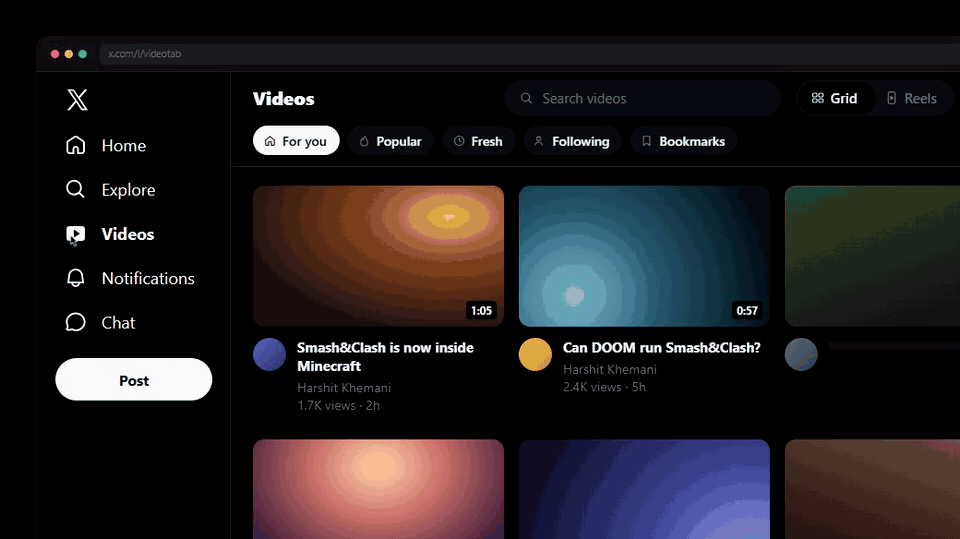

# xVideos

<sub>A Videos tab for X. Not the one you're thinking of.</sub>

**What if X had videos?** xVideos is a Chrome extension that adds a **Videos** tab to x.com. Browse videos in a grid, watch them with an Up next column and theatre mode, or swipe through them as Reels with double-tap to like.



<sub>Demo loop built with [Stageshow](https://github.com/AgentsORG/design-engineering). The phone-width version is in [`docs/loop-compact.gif`](docs/loop-compact.gif).</sub>

## Install

1. Download `xvideos-<version>.zip` from the [latest release](https://github.com/HKTITAN/xVideos/releases/latest) and unzip it.
2. Open `chrome://extensions`, turn on **Developer mode** (top right), click **Load unpacked** and pick the unzipped folder.
3. Open [x.com](https://x.com). **Videos** sits under Explore in the sidebar.

It works in Chrome, Edge, Brave, Arc and other Chromium browsers. You need to be signed in to X.

## What it does

| | |
|---|---|
| **Feeds** | For you, Popular, Fresh, Following, Bookmarks, and any search you run. Each one is real X data. |
| **Search** | X's own suggestions as you type: topics, plus people (pick one to get their videos). Recent searches are saved. |
| **Grid** | Hover a card to preview it. Vertical videos get a Shorts shelf. A blue bar shows how far you got. |
| **Watch** | Custom player with seek preview, quality menu, picture in picture, fullscreen and **theatre mode** (`T`). It resumes where you left off. Up next autoplays. |
| **Replies** | The post's replies, a reply box, and "Show more replies". |
| **Actions** | Like, repost, bookmark and reply. Double-tap the video to like it. |
| **Reels** | Full-height vertical feed. Double-tap to like, `C` opens the replies beside it. |
| **Offline-friendly** | Videos you've seen are kept in the extension's storage, so a feed never opens blank. A fresh install has a starter set. |

### Keyboard

| Key | Grid | Watch | Reels |
|---|---|---|---|
| `/` | Focus search | | |
| `R` | Reels | Reels from this video | |
| `Space` / `K` | | Play / pause | Play / pause |
| `J` / `L` | | Back / forward 10 s | |
| `←` / `→` | | Back / forward 5 s | |
| `↓` `↑` / `J` `K` | | | Next / previous |
| `F` | | Fullscreen | |
| `T` | | Theatre mode | |
| `M` | | Mute | Mute |
| `H` | | Like | Like |
| `C` | | | Replies |
| `Shift` + `N` | | Next video | |
| `Esc` | | Back to grid | Close replies, then grid |

## How it works

- **No API key, no server.** [`src/hook.js`](src/hook.js) runs in the page and reads the GraphQL responses X already fetches. It keeps the posts with a native video and passes them to the UI. Nothing leaves your browser.
- **Feeds load inside X's own app.** X signs every API request with a header its client computes, so the extension never calls the API itself. Each feed is a hidden x.com page (a search, your home timeline, your bookmarks) whose responses the hook reads. [`rules.json`](rules.json) lets only those marked frames (`xvtfeed=1`) load inside x.com. Every other x.com page keeps its clickjacking protection.
- **Likes, reposts and bookmarks** click X's real buttons on the post's own page, loaded in a hidden frame, so they go through exactly as if you'd clicked them on X. Replies are read from that page too. Sending a reply types into X's reply box there, and falls back to X's own composer if that box can't be found.
- **Playback** uses X's MP4 files. If one fails or stalls, the player steps down a quality, then up, then shows a real error with **Try again** and **Open on X**.
- **Loading states** use [skullet](https://skullet.lochie.me), which measures a sample render and draws a skeleton in its exact shape.

## Develop

```bash
npm install
npm run build   # rebundles src/vendor/skullet.js from the skullet package
```

Load the folder unpacked (see Install). After editing, open any x.com URL ending in `#xvt-reload`. That reloads the extension and the tab, with no trip to `chrome://extensions`.

- `build/make-seed.mjs` turns `build/seed-rows.json` into `src/seed.json`, the starter videos for a fresh install.
- `build/record-loop.mjs` records the Stageshow demo loop to `docs/`.
- `build/pack.mjs` writes the release zip.

## Notes

- This is an unofficial extension and isn't affiliated with X Corp. It works by reading the pages you already load. When X changes its markup or GraphQL, parts may break until they're updated.
- X's terms restrict automated access. The extension only loads the pages you ask for and acts only when you click, but use it at your own risk.

## License

MIT. Bundles [skullet](https://github.com/lochie/skullet) (MIT, see `src/vendor/SKULLET-LICENSE`).
